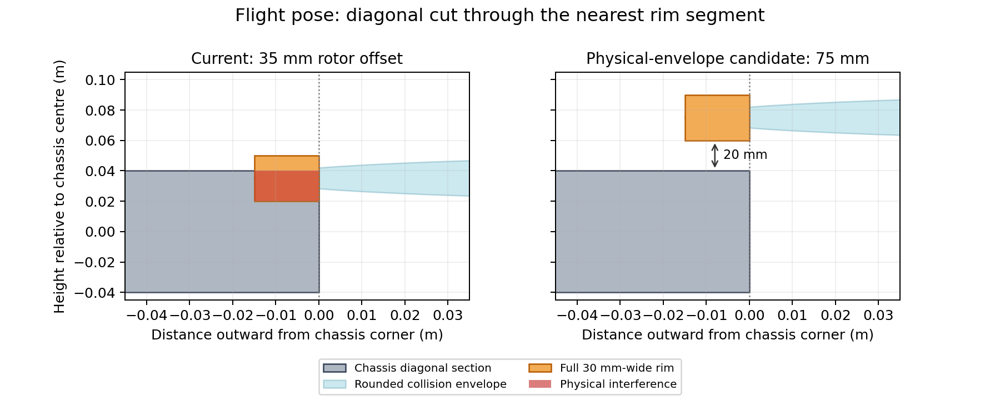

# Baseline hardware simulation validation — 2026-11-13

This is the **pre-redesign audit**. See [REDESIGN.md](REDESIGN.md) for the subsequent independent-drive / 90° fold / 100 mm standoff implementation and its separate evidence. Configuration descriptions and failures below refer to the baseline, not the new defaults.

**The current hardware layout is not build-ready.** The earlier successful missions establish controller behavior in an approximate collision model. This deeper audit found physical-envelope interference, sensitivity to CG/thrust errors, and a ground-contact fidelity limit. No material strength, thermal rating or real motor capability has been certified.

## 1. Geometry: a blocker hidden by disabled self-collision

The current 35 mm ring offset intersects the 160 × 160 × 80 mm chassis, even in the flight pose. The shipped rounded collision mesh produced 112 intersecting sampled fold/steer states. One flight witness is approximately `(0.0753, 0.0753, 0.0350)` m in chassis coordinates; its radius within the rotor is about 126.7 mm, within the stated 120–135 mm annular rim. This is not just overlap with the empty centre of a ring.



With self-collision explicitly enabled, the original configuration failed takeoff. The generated SDF was checked for `<self_collide>true</self_collide>`; the DART implementation uses that flag to enable self-collision checks ([primary source](https://raw.githubusercontent.com/gazebosim/gz-physics/gz-physics7/dartsim/src/SDFFeatures.cc)).

A **60 mm offset / 25° steering stop** passed 948 ring/chassis checks against the rounded collision mesh with a 5 mm inflated chassis, and the sampled ring/ring checks. It also completed the self-collision-enabled mission. However, that rounded mesh is thinner near the rim than a full 30 mm-wide annulus. A full-width rotating envelope still intersects the chassis at this candidate: one 25° ground-pose witness has rotor radius approximately 134.5 mm and axial coordinate -14.5 mm, inside the actual rim region. The dense physical-envelope audit found 18 intersecting samples.

A **75 mm offset / 25° steering stop** passed 948 checks with the conservative full-width rim envelope, a 5 mm inflated chassis, steering checked through ±26° to include stop margin, and the sampled ring/ring checks. That proves only sampled rigid geometric clearance, not blade deflection, servo/mount housing clearance or structural stiffness. The nominal rim was represented by a circumscribed 128-sided cylinder; using this larger convex envelope is conservative for clearance of the rotating annulus.

## 2. Full Gazebo hardware sensitivity matrix

All runs used isolated ROS domains and unique Gazebo partitions. Motor torque limits, controller tolerances and the original mission drift stop were retained. The first seven rows use the **60 mm / 25° rounded-contact candidate**, with self-collision enabled. They are not validation of the full-thickness physical rim.

| Case | Mission | Worst drive cross-track | Final goal error |
|---|---|---:|---:|
| Rounded-contact candidate, nominal 1 Nm / 1.5 rad/s servo | Complete | 2.5 cm | 1 cm |
| Servo torque 0.5 Nm | Complete | 0.5 cm | 1 cm |
| Servo torque 0.25 Nm | Complete | 0.7 cm | 1 cm |
| Servo speed 0.5 rad/s | Complete | 0.9 cm | 2 cm |
| Wheel friction coefficients ×0.4 | Complete | 1.0 cm | 2 cm |
| Wheel friction coefficients ×1.5 | Complete | 3.9 cm | 2 cm |
| Knuckle mass 40 g each, controller still estimates 20 g each | Complete; **accuracy screen failed** | 1.3 cm | **16 cm** |
| Original 35 mm / 35° geometry, self-collision on | **Takeoff failed** | — | — |
| 75 mm / 25°, full-width cylinder contact, self-collision on | **Stopped before tunnel** | Aborted at 9.3 cm offset | — |

A completed mission alone is insufficient: the post-validation accuracy screen requires goal error ≤10 cm and drive cross-track ≤5 cm. Six of the seven rounded-candidate cases met that screen. Friction multipliers affect the wheel surface; the floor's coefficient remains 1.0, so the high-friction case is capped by contact combination rather than being a uniform 1.5× increase in effective traction.

The full-width-rim candidate flew over the wall and folded but drifted on the approach and stopped. Its behavior differs markedly from the rounded collision model. This is a contact-model sensitivity result, not proof that a real tyre will drift by exactly that amount. A physical steering cart and calibrated contact/compliance model are needed before further tuning can support a hardware claim.

### Tunnel footprint constraint

The larger physical envelope also invalidates blindly carrying over the 5 cm drift allowance. At 75 mm offset, 10° wheel steering and 1° heading error, the computed width is about **436 mm** in a 500 mm tunnel. Accounting for the asymmetric envelope and a 5 mm buffer leaves only **24 mm** cross-track allowance in that sampled pose. A hardware implementation needs a footprint-aware stop rule (or a more conservative corridor/steering design), not the current fixed 50 mm rule. At 25° steering, the same buffer is not available even at zero cross-track error in one sampled heading. The controller already limits requested steering in the tunnel to roughly 10°, but servo tracking faults and larger heading errors are not qualified.

## 3. Flight uncertainty: 75 reproducible seeded runs

The Python rigid-body plant now supports actual CoM offset and per-rotor thrust scaling. Controller settings were held fixed at the nominal 1.72 kg front-steering model. Each case used three fixed noise seeds, an initial 3D step with 45° yaw and a one-second lateral gust. Standard duration was 8 seconds, with explicit 16-second CG follow-ups. A pass requires final position error <10 cm, yaw error <5° and speed <0.2 m/s. Tilt >60°, height <0.1 m or excessive excursion is classified as a crash.

**48 of 75 challenge runs met all criteria; 18 crashed.** This is a deliberately chosen stress grid, not an estimate of real-world reliability.

| Perturbation | Outcome |
|---|---|
| Nominal; +100 g or +250 g payload | 3/3 passes per case |
| Motor peak torque reduced from 0.4 to 0.30 Nm | 3/3 passes |
| Peak torque reduced to 0.25 Nm | 3/3 crashes |
| Estimated rim drag ×0.5 or ×2 | 3/3 passes per case |
| Uniform 20% thrust-coefficient loss, unchanged controller calibration | 3/3 crashes |
| One rotor loses 20% thrust coefficient | 3/3 crashes |
| Inertia ±20%; delay 20/40 ms; doubled sensor noise | 3/3 passes per case |
| Lateral gust 3 N or 5 N for one second | 3/3 passes per case |
| 80 g rings, corresponding added vehicle mass | 3/3 passes |
| Unmodelled 5 mm CG offset | Missed the 8 s accuracy criterion; 3/3 passes by 16 s, worst error <4.4 cm |
| Unmodelled 10 mm forward CG offset, 16 s follow-up | 3/3 crashes |
| Combined payload/torque/drag/thrust/CG/delay degradation | 3/3 crashes |

Thrust loss was perturbed independently of aerodynamic drag; this is an uncertainty probe, not a calibrated damaged-propeller model. The Python plant has explicit quadratic rim drag and motor torque limits. Gazebo still uses the existing velocity-actuator approximation and linearized rim damping, so agreement between the two implementations has not been established across this envelope. No CFD, ground contact, voltage sag, motor heating or finite flight-lock compliance is represented in this flight sweep.

## 4. Measured joint loads and sizing bounds

The optional logger requests Gazebo's joint transmitted wrench and records joint-frame forces/moments at approximately 250 Hz. These are not motor currents. The [DART implementation](https://raw.githubusercontent.com/gazebosim/gz-physics/gz-physics7/dartsim/src/JointFeatures.cc) transforms the child body's transmitted wrench to the joint frame. Ideal hard constraints, contact discretization and timestep affect peak values. Logging is buffered and sampled; shutdown can lose a final buffered interval, and sampled peaks are not guaranteed continuous-time maxima.

In the completed rounded-contact candidate mission:

- Airborne, locked steering-axis moment: **1.58 Nm peak**, **0.215 Nm RMS**; bending moment up to **2.15 Nm**.
- Folded-ground steering-axis moment: **0.825 Nm peak**, **0.061 Nm RMS**.
- Folding/contact bending moment: **15.2 Nm peak**, with **123 N** peak transmitted force. These rigid-contact impulses require careful model calibration and must not be treated as certified bracket loads.

A provisional 2× screen on the sampled airborne steering-axis peak is about **3.2 Nm**, but it is not a specified latch rating or a substitute for structural/fatigue tests. The latch remains ideal and unbreakable in Gazebo. A servo torque limit that completes a mission does not establish continuous rating, gear strength, stall heating or backlash tolerance. Ground moments can include passive/constraint effects and must not be equated directly to commanded actuator torque.

From the existing 60 g rotor inertia and assumed 700 KV motor:

| Quantity | Calculated estimate |
|---|---:|
| Nominal hover rotor speed | 520 rad/s, approximately 4,966 rpm |
| Rim speed at hover / maximum | 70 / 108 m/s |
| Stored energy per rotor at hover / maximum | 136 / 323 J |
| Uniform-rim tension estimate at hover / maximum | 329 / 779 N |
| Ideal torque-producing current at hover / 0.4 Nm peak | 11.8 / 29.3 A |
| Wheel speed at 0.4 m/s | Approximately 28 rpm |

The rim-tension estimate assumes all 60 g is uniformly distributed at the mean radius; it is a sizing bound, not a stress result. Strength cannot be evaluated without actual section area, material, joints and manufacturing data. Low-speed driving requires controlled bidirectional torque at very low rpm; the simulator does not validate sensorless startup, cogging or an actual ESC/FOC implementation. Battery endurance calculations remain estimates because resistance, efficiency maps, ESC limits, cooling and actual rim drag are unmeasured.

## 5. What is established, and what is still required

Established in simulation: a geometry inconsistency in the current model; feasible sampled rigid clearances for a larger envelope; nominal rounded-candidate mission performance across selected actuator/traction/mass changes; finite controller sensitivity limits; and approximate joint load demands. **Neither the current default nor either candidate is approved for fabrication from these results.**

Before a hardware commitment:

1. Choose the actual rim cross-section and provide full CAD for body, blades, motor/servo housings, linkage and stops. Resolve the interference and check the dynamic tunnel footprint including deflection/tolerances.
2. Measure thrust, drag, spin-up and current vs rpm on one representative ring/motor/ESC assembly; calibrate the flight model and actual CoM/inertia.
3. Test a folded steering cart on the target floors. Validate the tyre contact model, reverse/startup behavior, steering limits and fault-stop behavior.
4. Design and test a positive flight latch and mounts against measured loads with finite stiffness, backlash, strength and fatigue margins.
5. Validate electrical/thermal endurance and containment of the measured rotor energy. No such qualification follows from the current rigid-body simulator.

## Reproduction and evidence

`hardware-results/summary.json` records individual case status, accuracy screens, load statistics and source hashes at report generation. Raw load traces are preserved as `.csv.gz`; mission logs, failed/interrupted attempts and JSON sweeps remain under `hardware-results/`. Some cases were resumed from completed runs after interruption; the matrix marks them `cached`. A prior quarter-torque attempt hit a wall-clock watchdog and was retained separately; its resumed complete run passed. Incomplete trailing CSV records from process termination are counted and excluded from statistics, not silently treated as zero loads.

Commands inside the sourced ROS container, from the repository root:

```bash
python3 -m pytest -q src/ringquad_control/test
PYTHONPATH=/usr/lib/python3/dist-packages python3 scripts/hardware_geometry.py
PYTHONPATH=/usr/lib/python3/dist-packages python3 scripts/hardware_geometry_checks.py
PYTHONPATH=/usr/lib/python3/dist-packages python3 scripts/hardware_clearance_candidates.py
PYTHONPATH=/usr/lib/python3/dist-packages python3 scripts/hardware_candidate_verify.py --clearance .005 --output hardware-results/candidate-five-mm.json
PYTHONPATH=/usr/lib/python3/dist-packages python3 scripts/hardware_candidate_verify.py --physical-rim --ring-offset .075 --clearance .005 --output hardware-results/physical-rim-75mm.json
OPENBLAS_NUM_THREADS=1 PYTHONPATH=src/ringquad_control:/usr/lib/python3/dist-packages python3 scripts/hardware_flight_sweep.py
python3 scripts/hardware_gazebo_matrix.py
python3 scripts/demo_test.py --runs 1 --steering front --tread rubber --timeout 900 \
  --output hardware-results/physical-candidate-mission \
  --model-arg ring_offset .075 --model-arg steering_limit_deg 25 \
  --model-arg tread_collision cylinder --model-arg self_collision true
python3 scripts/hardware_report.py
```

The numerical geometry utilities require NumPy/SciPy; the figure utility additionally requires Matplotlib. The container's distribution numerical stack was selected explicitly for ABI compatibility. Model perturbations hold controller mass calibration nominal to expose hardware/assembly uncertainty. The new parameters are validation controls, not automatically qualified hardware settings. Default runtime geometry has deliberately not been replaced by an unvalidated candidate.
