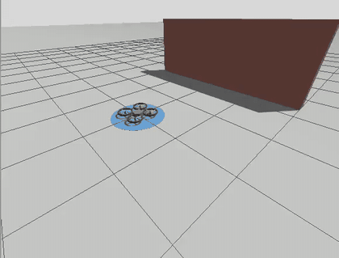

# RingQuad

**Outstanding work:** [remaining hardware blockers and closure criteria](HARDWARE_BLOCKERS.md).

**Current hardware candidate:** independent propellers and wheel drives, upright 90° fold, 100 mm axis standoff, inboard rear V-race carriers, front steering with 25° stops, breakable steering latches, and self-collision enabled. The provisional mass budget is **2.65 kg**. Simulation uses finite motor torque and a pinned, patched Bullet Featherstone engine. See [hardware proposal and validation](hardware-blockers/REPORT.md), [engine setup](hardware-blockers/physics/README.md), and the historical [1.98 kg redesign](REDESIGN.md). Hardware qualification remains open.

**Hardware-validation update:** deeper checks found chassis/rim interference and strong contact-model sensitivity. The successful controller demos are not hardware qualification. See [HARDWARE_VALIDATION.md](HARDWARE_VALIDATION.md) before using this model as a build specification.

A quadrotor whose propellers sit inside rings that fold down into independently driven wheels. Flies over obstacles, drives through spaces it cannot fly through. ROS 2 Jazzy + Gazebo Harmonic. Design: [DESIGN.md](DESIGN.md).



The demo course ([worlds/demo.sdf](src/ringquad_description/worlds/demo.sdf)): a 1.5 m wall to fly over, then a tunnel 0.5 m wide and 0.4 m high. Spread out the drone is about 0.6 m wide and cannot fly through; folded it is about 0.36 m wide and drives through. GIF at 2x; [demo.mp4](media/demo.mp4) is real time.

**This recording used ideal motors.** With them the run was autonomous and repeatable (46–51 s, worst sideways error in the tunnel 0.1–1.7 cm, landing within 0–8 cm of the goal pad centre, four runs). The simulation now defaults to realistic motors, drag and sensor noise, the original cylinder-contact tunnel tests failed. This branch adds rounded contact and active ground-heading alignment with omni tread; see [Tunnel-control experiment](#tunnel-control-experiment).

## Run (macOS or Linux with Podman)

```bash
./run.sh
```

Open http://localhost:6080 for the desktop. In a terminal there:

```bash
cd ~/ringquad_ws && colcon build --symlink-install && source install/setup.bash

# Gazebo + RViz + controller (tread:=rubber|omni|mixed, default rubber)
ros2 launch ringquad_control sim.launch.py

# RViz only, fold the arms with sliders
ros2 launch ringquad_description display.launch.py
```

```bash
# demo course + autonomous mission (front steering and rubber tread by default)
ros2 launch ringquad_control demo.launch.py
```

From the Mac, `scripts/sim_restart.sh` (re)starts the simulation in the running container; it passes its arguments to `sim.launch.py` (for example `scripts/sim_restart.sh world:=demo`).

## Commands

The controller node is the only thing that commands the motors and the fold. Pick a mode:

```bash
# take off to 1 m above the current spot
ros2 topic pub --once /ringquad/mode std_msgs/msg/String "{data: fly}"

# fly to a point (odom frame) and heading
ros2 topic pub --once /ringquad/goal geometry_msgs/msg/PoseStamped \
  "{pose: {position: {x: 1.0, y: 0.5, z: 1.5}, orientation: {z: 0.707, w: 0.707}}}"

# land; switches to idle on touchdown
ros2 topic pub --once /ringquad/mode std_msgs/msg/String "{data: land}"

# on the ground only: fold into wheels and drive with /cmd_vel
ros2 topic pub --once /ringquad/mode std_msgs/msg/String "{data: drive}"
ros2 topic pub -r 10 /cmd_vel geometry_msgs/msg/Twist "{linear: {x: 0.5}, angular: {z: 0.5}}"

# motors off, arms unfolded
ros2 topic pub --once /ringquad/mode std_msgs/msg/String "{data: idle}"
```

## Tests

```bash
# unit tests: mixer, flight controller on the realistic plant, yaw-rate loop, line following
cd ~/ringquad_ws/src/ringquad_control && python3 -m pytest -q test

# end to end against a freshly started sim.launch.py
python3 ~/ringquad_ws/scripts/mission_test.py

# rotor / gain comparison on the realistic model (no Gazebo)
cd ~/ringquad_ws/src/ringquad_control && PYTHONPATH=. python3 ~/ringquad_ws/scripts/realism_sweep.py
```

`mission_test.py` with realistic motors and a noisy IMU (default):

| Check | Result |
|---|---|
| Take off to 1 m | 2.1 cm error |
| Fly to (1, 0.5, 1.5) m + yaw 90 deg | 2.6 cm, 0.1 deg error |
| Land and disarm | on the ground, idle |
| Fold into wheels (rings stopped first, slow fold) | 79.7–80.0 deg |
| Drive at 0.5 m/s | 0.50 m/s, 0.01 m/s sideways |
| Turn request while driving does not stall the drive | 0.42 m/s kept |
| Unfold | 0.5–0.6 deg |

## Realistic tests

The first version simulated ideal motors. Now the motors have a 0.4 Nm torque limit, the rings' real spin inertia, blade drag and an estimate of rim drag, and the controller sees delayed, noisy sensors. Main results ([DESIGN.md section 13](DESIGN.md)):

- **Flight works, but the 60 g rings need gentle control.** The first tuning diverges; roll/pitch gains are now 0.5x. A 20–40 g ring flies with margin.
- **Rim drag more than doubles hover power:** about 4 min of flight instead of about 11 with plain props (estimate; measure on a thrust stand).
- **An all-rubber tread cannot reliably skid-steer** with direct-drive motors on grippy floors. Omni rollers on the front rings (`tread:=mixed`) are the candidate fix; tyre contact is where the simulation stops being trustworthy, so it needs a physical test cart.
- **Fold only with the rings stopped, and slowly**, or the robot twists by tens of degrees.

## Layout

| Path | What |
|---|---|
| `src/ringquad_description/urdf/ringquad.urdf.xacro` | Robot model, motor models, fold controllers, sensors |
| `src/ringquad_description/worlds/` | `ringquad.sdf` empty world, `demo.sdf` demo course (1 ms physics, IMU system) |
| `src/ringquad_control/ringquad_control/` | `params.py` vehicle constants, `plant.py` realistic flight model, `mixer.py` allocation and skid steering, `flight.py` geometric controller, `ground.py` yaw-rate loop and line following, `node.py` ROS node and modes, `mission.py` demo mission |
| `media/` | Demo video and GIF |
| `scripts/mission_test.py` | End-to-end test |
| `scripts/realism_sweep.py` | Rotor and gain comparison on the realistic model |
| `scripts/drive_test.py` | Ground steering check (line following, arc turns) |
| `scripts/flight_log.py`, `scripts/motor_probe.py` | Diagnostics: log a take-off, hold a motor speed |
| `geometry.py` | Fold geometry and sizing calculator |
| `DESIGN.md` | Design spec |

## Tunnel-control experiment

The earlier experiment defaulted to `tread:=omni`; the redesign uses `tread:=rubber steering:=front`. Rubber and mixed remain selectable. The validation runner isolates every ROS domain and Gazebo transport partition and removes server descendants after each run; see SIMULATION_RESULTS.md for tread-specific results. The simulated tyre collision is a convex rounded profile with the original 0.135 m outer radius and 0.03 m width; ring mass and inertia are unchanged. It approximates rounded tread contact, not individual omni rollers. DART uses the Bullet collision detector. These contact assumptions require hardware validation.

Before driving, the mission actively aligns its heading within 1 degree after folding. If ground alignment stalls for 60 simulated seconds, it stops, compensates the measured heading error in the next aerial landing, and retries, up to three landing attempts. Forward motion previously began with up to 10 degrees of heading error despite weak steering. Cross-track abort limits remain 5 cm at the tunnel and 15 cm on the open approach.

Headless repeatability check (inside the sourced ROS workspace):

```bash
python3 scripts/demo_test.py --runs 3 --tread omni
```

Each run starts a fresh world and fails on mission abort, timeout, or missing completion. Logs default to `/tmp/ringquad-demo`. To run without the Gazebo desktop, pass `gui:=false rviz:=false` to either launch command. `scripts/generate_tread.py` regenerates the collision mesh from the repository root.

The test runner takes a file lock on its ROS domain so concurrent runs do not share topics. Each run gets a unique Gazebo partition. This prevents orphaned or concurrent simulators from contaminating commands and odometry.

## Optional front steering

`steering:=front tread:=rubber` adds two simulated steering knuckles and Ackermann wheel control. The original mechanism is selectable with `steering:=fixed`; the redesigned default is `steering:=front`. See [STEERING.md](STEERING.md) for hardware assumptions, flight trim, limitations and test commands.
