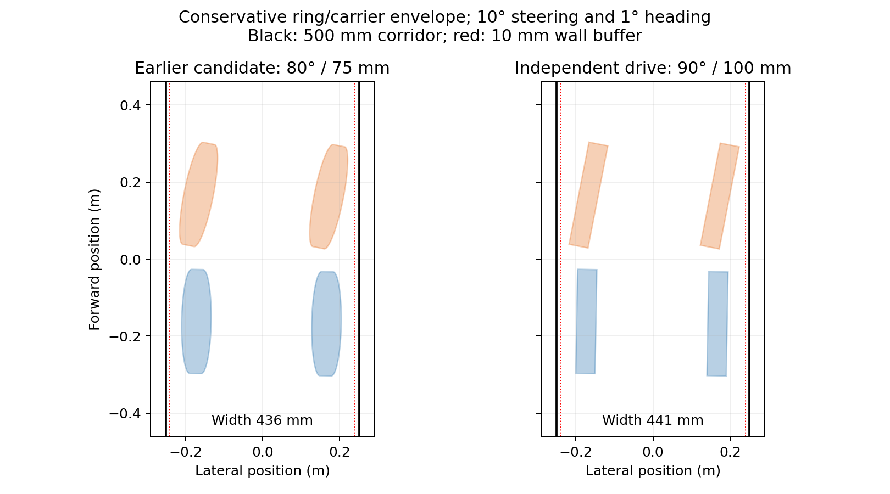

# Independent propeller and wheel-drive redesign

The spinning-rim architecture was rejected after repeated post-unfold flight crashes. **The revised concept uses a lightweight propeller inside each independently driven wheel ring.** This is a concrete simulation and parametric geometry revision, not a fabrication release. Baseline failures remain in [HARDWARE_VALIDATION.md](HARDWARE_VALIDATION.md).

## Mechanism

| Item | Baseline | Revised default |
|---|---|---|
| Flight drivetrain | Motor spins the entire 60 g rim and blades | Lightweight propeller spins inside a stationary wheel ring |
| Ground drivetrain | Same flight motor turns the rim | Four additional finite-torque wheel drives |
| Ground fold | 80°, retaining 10° wheel camber | 90°, upright wheels and vertical front steering axes |
| Ring-axis standoff | 35 mm | 100 mm, accommodating a rear carrier |
| Front steering | Optional, up to 35° | Enabled, 25° commanded stop plus joint stop tolerance |
| Wheel section | Rectangular rim with approximate contact geometry | Physical elliptical crown with an enclosing collision hull |
| Self-collision | Disabled | Enabled |

The ring is an annular solid with major radius 127.5 mm, radial semi-axis 7.5 mm and axial semi-axis 15 mm: 270 mm outside diameter, 240 mm minimum inside diameter, and 30 mm maximum width. `scripts/generate_crowned_tread.py` generates the physical annular mesh and its slightly inflated convex collision hull. Both visible geometry and contact geometry change. The ring does not rotate at flight rpm.

A three-spoke **stationary rear carrier**, located 30 mm behind the propeller plane, supports three perimeter rollers. The wheel rotates independently on its support; carrier spokes do not cross the propeller plane. The simulated wheel joint represents the bearing/drive constraint. Roller shapes are visual; detailed roller bearing contacts, belt/gears, preload, housings and wiring are not simulated or specified for manufacture.

Propeller blade tips end at 115 mm radius. Including pitched blade thickness and chord, the computed swept radius is 115.67 mm, leaving a rigid radial clearance lower bound of **4.33 mm** inside the rim. The hub/blade envelope has at least **21 mm** axial clearance to the carrier spokes. Deflection, tolerances and real bearing alignment still need a complete CAD assembly and tests. The 100 mm standoff is a carrier/shaft-axis geometry dimension, not permission to use an unsupported 100 mm motor shaft.

Mass is explicitly increased: the baseline 1.68 kg plus four 50 g carrier/drive allowances, four additional 15 g propellers and two 20 g steering knuckles gives **1.98 kg nominal**. These are design budgets, not weighed component selections. Carrier/drive mass is lumped in the arms; full component mass distribution and steering inertia remain approximate. A heavier-drive flight sensitivity case raises each allowance to 80 g.

Wheel torque remains capped at **0.33 Nm** in Gazebo, with 20 rad/s speed limit and 0.1 s actuator time constants. Flight motor torque also remains capped at 0.33 Nm in Gazebo; the numerical flight plant uses 0.4 Nm nominal and explicitly tests lower values. No unlimited actuator was introduced. Propeller commands use `/ringquad/motor_speed`; wheel commands use `/ringquad/wheel_speed`. Both bridged actuator arrays retain FL, FR, RL, RR order. The public mode, goal and `/cmd_vel` interfaces remain the mission inputs. Wheels brake during flight/folding; propellers stop before folding and stay stopped while driving.

The shorter propeller receives a provisional thrust-coefficient derating of `(.115/.12)^4` from the previous assumed coefficient. This is a conservative modelling assumption, **not a measured aerodynamic map**. The numerical plant includes propeller plus motor-bell spin inertia; Gazebo resolves the propeller link with an approximate inertia. Neither model establishes real thrust, current, efficiency or heating.

## Why the smaller revisions were rejected

The initial 35 mm layout intersected the chassis. Larger offsets fixed sampled rigid clearance, but the 80° square-rim contact model drifted. Upright square rims completed individual missions but were inconsistent during folding and driving. A physical crowned rim improved tracking, yet the shared drivetrain still crashed in repeated flight trials, including with a slower 0.5 m/s flight reference and fully unfolded/locked joints.

These failed and interrupted attempts are preserved under the `redesign-*` result folders. The early `separate-drive-*` folders are prototype trials before the final rear carrier, blade gap and mass budget; they are not counted as the final suite. The `independent-final-*` folders contain completed fine-contact-mesh audit cases and interrupted follow-up attempts. The `final-default` and `final-matrix` folders contain the final repeatability/sensitivity suite using the optimized conservative contact hull. No failed attempt was erased or reclassified as a pass.

## Controller and safety

Fold angle, drivetrain, standoff, tread and steering stop propagate through the launch files. Contact track is derived from geometry; upright nominal wheel track is 360 mm. Ackermann curvature uses that track. Configured steering-knuckle mass is included in flight weight and forward CG allocation.

The flight carrot speed is 0.5 m/s, with a longer travel deadline and unchanged arrival accuracy. Actuation waits for fold joints within 0.5° of their stop. Landing at the tunnel line requires arrival within 25 mm and speed below 0.04 m/s. Entering descent preserves the learned hover trim. Final flight arrival requires 50 mm and 0.05 m/s. Mission odometry velocity is rotated from body to world coordinates.

Near the tunnel, the mission evaluates a conservative **ring plus rear-carrier envelope** using measured fold/steering joints and body heading. It checks current bounds and a 0.4-second projected stopping horizon with a 10 mm wall buffer; stale or missing joint data and excessive ground tilt cause a stop. Steering requests are capped near 10° in the corridor. The original cross-track stop remains an additional check. This planar screen does not prove braking distance on an unknown floor or replace independent sensing/interlocks.

## Geometry verification

`hardware-results/independent-final-geometry.json` reports **2,028 sampled chassis checks, zero intersections**, using a 5 mm inflated chassis, another 0.2 mm envelope padding, and a conservative asymmetric cylinder enclosing the rim and rear carrier (`z = -35 .. +15 mm`). Steering is checked through ±26°, beyond the 25° command stop, over folds 75–90°; below 75°, steering is locked to zero. Sampled ring/carrier pair checks also found zero intersections. This is sampled rigid clearance, not proof for every continuous pose, deflection or unmodelled part.

`crowned-mesh-check.json` checks actual inner/outer radii and width, and containment of 12,000 samples of the analytic crown surface by its collision hull. An exact analytic support-function check against every hull plane also passes. The physical mesh remains 128 × 64 samples; contact uses 64 × 32 samples with a 0.2 mm inflation to keep the simulator practical. `--fine-contact` regenerates the earlier audit hull. `independent-prop-clearance.json` checks the propeller sweep and rear-carrier axial gap independently.



The nominal straight rim footprint is 390 mm wide; steering and heading enlarge it, so safety uses the actual bounds rather than a fixed drift allowance.

## Final simulation results

The isolated interface test uses odometry simulation time with a separate wall-clock watchdog. An earlier wall-clock wait incorrectly flagged unfolding when the simulator ran slowly; that attempt is retained under `redesign-steering-walltime-attempt`. Steering tracking in that attempt already measured +0.1999 and -0.1995 rad/s for ±0.2 rad/s requests, with propellers stopped and wheels rotating independently. The corrected complete check is recorded under `redesign-steering`.

The generated-model audit independently confirms 1.98 kg total mass, four propeller joints, four independent wheel joints, matching derated thrust coefficients, finite 0.33 Nm effort limits and enabled self-collision.

Results and source hashes are collected in `hardware-results/redesign-summary.json`. The required suite is three nominal missions and five actuator/traction/mass sensitivity missions. Each must complete with goal error ≤100 mm, drive cross-track ≤50 mm and positive buffered tunnel margin. Gazebo wrappers can require SIGTERM after mission completion; all descendant processes are removed by the isolated runner. Mission success is not a uniformly clean middleware-shutdown claim.

<!-- RESULTS -->
**Final suite: 8/8 missions passed.** Build and all **44 automated tests** passed. The separate interface test passed all seven steps, and bidirectional steering measured +0.2002 / -0.1999 rad/s for ±0.2 rad/s requests. Propellers remained stopped while wheels drove. Production-source hashes match those captured at the sensitivity suite start.

| Case | Duration (sim s) | Goal error (cm) | Worst drive cross-track (cm) | Minimum buffered margin (mm) |
|---|---:|---:|---:|---:|
| Nominal 1 | 74 | 9 | 1.4 | 38.5 |
| Nominal 2 | 76 | 2 | 1.0 | 39.6 |
| Nominal 3 | 74 | 4 | 1.4 | 38.8 |
| heavier_knuckles_calibrated | 72 | 2 | 0.7 | 37.8 |
| high_traction | 76 | 3 | 1.1 | 38.6 |
| low_traction | 75 | 2 | 0.1 | 37.5 |
| servo_quarter_torque | 75 | 2 | 0.8 | 37.6 |
| servo_slow | 72 | 3 | 1.1 | 38.5 |

Maximum reported cross-track was **1.4 cm**, maximum final goal error **9 cm**, and minimum buffered tunnel margin **37.5 mm**. These are selected simulated scenarios, not hardware reliability statistics.
<!-- /RESULTS -->

The final Python-plant flight stress grid ran **60 seeded cases: 51 met all accuracy criteria, none crashed**. Payload +100/+250 g, unmodelled 5/10 mm CG offsets, reduced 0.30/0.25 Nm torque, inertia ±20%, delay 20/40 ms, doubled sensor noise, 3/5 N gusts and heavier drive budgets passed their three seeds. The 10 mm CG cases and combined case use explicit 16-second durations; other cases use 8 seconds. Criteria remain final position <100 mm, yaw <5°, speed <0.2 m/s; a crash is tilt >60°, height <0.1 m or excursion >10 m.

**Unknown 20% uniform thrust loss, one weak motor and the combined adverse case missed position accuracy**: approximately 0.41 m, 0.64 m and 0.54 m residual errors respectively. They did not crash in this grid. This improvement is not a reliability probability or a blanket fault-tolerance claim. Thrust/CG calibration and an enforced operating envelope are still necessary. The baseline shared-rim stress failures and earlier experimental controller probes remain separately preserved; they are not results for the final architecture.

## Hardware limitations

The positive steering flight lock remains ideal and unbreakable. Earlier joint-load measurements belong to the rejected shared-rim configurations and **must not be used as final-architecture load ratings**. The carrier, wheel drive, latch and propeller need actual parts, full assembly CAD, mass measurements, finite stiffness/backlash models, structural/fatigue tests and current/temperature measurements. The model uses rigid constraints and simplified contact/aerodynamics; it does not certify motor maps, gearing, roller preload, cooling, battery sag, containment or endurance.

The sizing calculation in `independent-sizing.json` gives about 20.3 J rotating energy per propeller/motor assembly at nominal hover, versus 136.4 J per old spinning rim at its old nominal hover, and about 7.8 times lower angular momentum per assembly. Assumed maximum static thrust-to-weight is 1.73. These are model-derived estimates, not measured ratings.

The revised architecture removes the high-speed spinning wheel rim and its large flight gyroscopic/storage-energy burden. It introduces additional motors, bearings and transmission packaging. It remains a simulation-supported design proposal, with physical qualification open.

## Reproduction

Inside the sourced ROS container, from the repository root:

```bash
colcon build --symlink-install
source install/setup.bash
python3 -m pytest -q src/ringquad_control/test
OPENBLAS_NUM_THREADS=1 PYTHONPATH=/usr/lib/python3/dist-packages python3 scripts/check_crowned_tread.py
python3 scripts/check_independent_clearance.py
OPENBLAS_NUM_THREADS=1 PYTHONPATH=/usr/lib/python3/dist-packages python3 scripts/hardware_candidate_verify.py \
  --physical-rim --carrier --ring-offset .1 --fold-ground-deg 90 --envelope-padding .0002 \
  --clearance .005 --output /tmp/independent-geometry.json
python3 scripts/demo_test.py --runs 3 --timeout 900 --output /tmp/independent-default
python3 scripts/redesign_validation.py --output /tmp/independent-matrix
OPENBLAS_NUM_THREADS=1 OMP_NUM_THREADS=1 PYTHONPATH=src/ringquad_control:/usr/lib/python3/dist-packages \
  python3 scripts/separate_drive_flight_sweep.py
```

Defaults select the independent-drive concept. `drivetrain:=shared` is available for comparison; the archived pre-redesign numbers are historical measurements with source hashes/settings, and current code is not an exact replay of that uncommitted baseline snapshot. The commands above validate the current architecture. Numerical utilities require NumPy/SciPy; plotting additionally requires Matplotlib. The selected distribution numerical stack avoids the container's NumPy/SciPy ABI mismatch.
